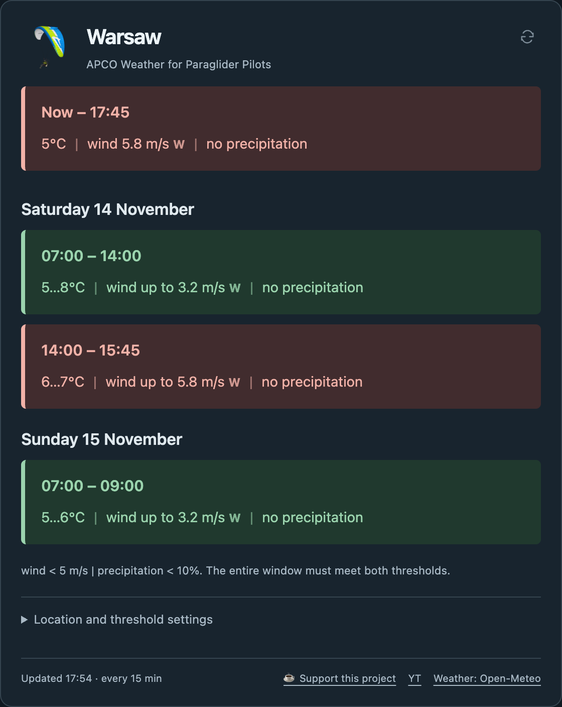
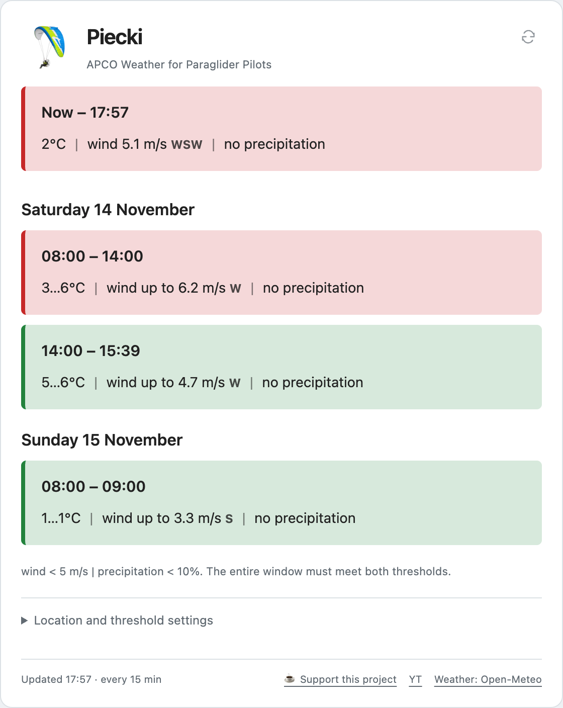

# APCO Maniacs

[Polski](README.pl.md) · [English](README.md) · [Italiano](README.it.md) · **Español**

Tarjeta meteorológica de Home Assistant para pilotos de parapente. Elige un punto exacto en el mapa, establece los umbrales de viento y precipitaciones y consulta las horas consecutivas con la misma evaluación agrupadas en ventanas meteorológicas.

Capturas del componente independiente en inglés, con temas claro y oscuro, realizadas el 13 de noviembre de 2026. Varsovia utiliza datos de demostración simulados (ventana verde de 07:00 a 14:00); Piecki muestra el pronóstico de Open-Meteo obtenido al hacer las capturas. La tarjeta instalada nunca utiliza los datos de demostración.





- Mapa nativo con marcador que puedes arrastrar en el editor visual; también permite introducir coordenadas manualmente.
- Pronóstico de Open-Meteo sin entidad meteorológica, integración Python ni clave API.
- Evaluación por horas, ventanas sin límite de tres horas y filtro de amanecer/puesta de sol.
- Polaco, inglés, italiano y español; fechas y números localizados y temas claros/oscuros de HA.
- Un único archivo de instalación, sin bibliotecas descargadas de CDN.

## Instalación mediante HACS

Repositorio: **https://github.com/piotrwozniak/apco-maniacs-card**.

1. Abre HACS → menú ⋮ → **Repositorios personalizados**.
2. Pega `https://github.com/piotrwozniak/apco-maniacs-card`, selecciona la categoría **Dashboard** y añádelo.
3. Busca **APCO Maniacs**, descarga la tarjeta y recarga el navegador.
4. Comprueba los recursos del panel en `/config/lovelace/resources`. HACS debería registrar `apco-maniacs-card.js` como módulo JavaScript. Si gestionas los recursos en YAML, añade manualmente la ruta indicada por HACS.
5. Añade **APCO Maniacs** desde la lista de tarjetas. Haz clic en el mapa o arrastra el marcador, introduce el nombre del lugar y guarda.

La ruta del recurso incluye el nombre del repositorio:

```text
/hacsfiles/apco-maniacs-card/apco-maniacs-card.js
```

Configuración YAML alternativa:

```yaml
type: custom:apco-maniacs-card
name: Mi despegue
latitude: 36.88
longitude: -5.40
language: es
timezone: Europe/Madrid
wind_threshold: 5
precip_threshold: 10
forecast_hours: 40
daylight_only: true
```

Cada tarjeta conserva su propia ubicación. El marcador no cambia la ubicación de casa de Home Assistant. Las tarjetas nuevas utilizan inicialmente las coordenadas de casa de HA. Si eliges un lugar en otra zona horaria, cambia también `timezone`: no se calcula automáticamente a partir del mapa.

## Idioma y localización

Sin `language`, la tarjeta sigue el idioma de la interfaz de HA: `pl`, `en`, `it` y `es`, incluidas variantes regionales como `es-ES` o `es-MX`. Para cualquier idioma no compatible se utiliza el inglés. Elegir explícitamente uno de los cuatro idiomas tiene prioridad sobre HA; los valores desconocidos también utilizan el inglés. Puedes cambiar el idioma en el editor visual.

Se traducen etiquetas, mensajes, días y meses. En español, los decimales utilizan coma. Las horas se muestran en formato de 24 horas y en la zona configurada. Fuera de HA el idioma predeterminado es el polaco, salvo configuración explícita. Los enlaces superiores permiten elegir el idioma de la documentación: GitHub y HACS no seleccionan automáticamente estos archivos.

## Migración desde la instalación manual anterior

Conserva las configuraciones existentes. Tras instalar mediante HACS, elimina el recurso antiguo `/local/warun-web/warun-card.js?...` y deja únicamente el de HACS. Cierra y vuelve a abrir la página para descartar la definición antigua del componente. Se mantienen `custom:apco-maniacs-card` y `custom:warun-card`. Puedes conservar los archivos antiguos de `www/warun-web` hasta comprobar la instalación nueva.

No sustituyas `configuration.yaml`, automatizaciones ni escenas. HACS instala solo la tarjeta, sin archivos de configuración de HA ni la integración Python Warun opcional.

## Instalación manual de un solo archivo

Copia [dist/apco-maniacs-card.js](dist/apco-maniacs-card.js) a `www/apco-maniacs-card/`. Añade `/local/apco-maniacs-card/apco-maniacs-card.js?v=1.0.6` como recurso de tipo **Módulo JavaScript**. Si acabas de crear `www`, reinicia HA. No necesitas archivos CSS, traducciones ni imágenes por separado.

La versión fuente de `warun-web/` también funciona de forma independiente y puede desplegarse con cuatro archivos. La guía detallada [wdrozenie.html](wdrozenie.html) está en polaco.

## Evaluación de las condiciones

Una hora es verde solo cuando el viento y la probabilidad de precipitaciones están **estrictamente por debajo** de los umbrales. Un cambio de evaluación, un hueco en los datos o un cambio de día inicia otra ventana. Los datos ausentes tienen su propia evaluación. La temperatura muestra el mínimo y máximo de la ventana; el viento y las precipitaciones muestran sus máximos. La dirección corresponde a la hora con el viento más fuerte.

Con el filtro de horas de luz, la ventana de hoy comienza al inicio de la hora actual; los días siguientes comienzan en la primera hora en punto a partir del amanecer. Las ventanas terminan como máximo en la puesta de sol. La evaluación sigue siendo horaria aunque el sol se ponga, por ejemplo, a las 17:24. El pronóstico se descarga cada 15 minutos; los datos antiguos o incompletos no se muestran como condiciones favorables.

La tarjeta ayuda a planificar, pero no evalúa rachas, turbulencias, térmicas ni efectos del terreno y no garantiza un vuelo seguro. Las coordenadas se envían a Open-Meteo para solicitar el pronóstico. El mapa lo gestiona el editor nativo de HA.

## Apoyo y vídeos

Si la tarjeta te resulta útil, puedes [invitarme a un café](https://buymeacoffee.com/piotrwoznil).

Vídeos y otros proyectos: [Piotrek Lata en YouTube](https://www.youtube.com/@piter_fly).

## Desarrollo y publicación

Se necesita Node.js 22 o posterior. No hay dependencias npm. El código independiente de `warun-web/` no requiere compilación.

```sh
npm run build
npm test
npm run check:dist
python3 -m unittest discover -s tests
```

`npm run build` genera el archivo HACS con CSS e ilustración integrados. Después de modificar el código, regenera y guarda `dist/apco-maniacs-card.js` en el repositorio. La CI comprueba las pruebas, la correspondencia del paquete con el código y la compatibilidad HACS.

Para otra versión, actualiza `package.json`, regenera `dist`, envía el commit, comprueba Actions y publica una release con la etiqueta correspondiente. El workflow `Attach HACS bundle` adjunta el archivo JS.

La instalación como repositorio personalizado no exige estar en el catálogo predeterminado de HACS: la solicitud al catálogo es otro paso. Las pruebas locales no sustituyen una prueba del mapa en una instancia de HA en funcionamiento.

Datos meteorológicos: [Open-Meteo](https://open-meteo.com/), [CC BY 4.0](https://open-meteo.com/en/terms). Proyecto comunitario independiente, no es un producto oficial de APCO Aviation. La ilustración se generó con IA utilizando APCO F1 MKII Azure #24 como referencia visual. Código fuente: [MIT](LICENSE).
