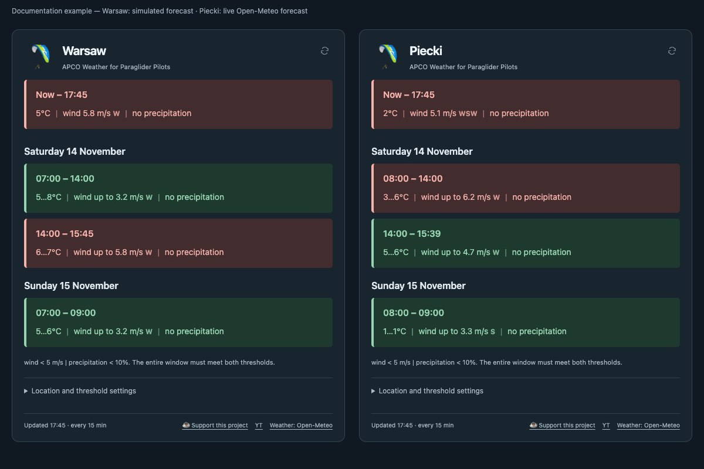
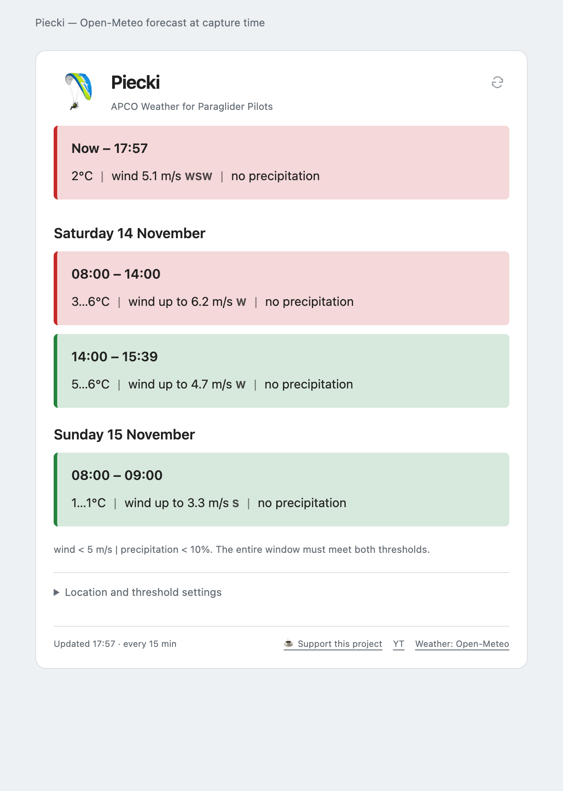
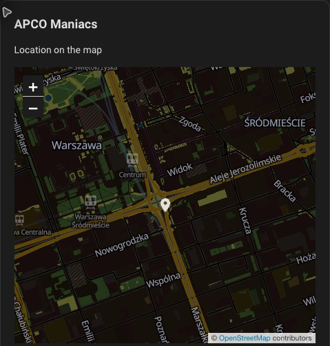

# APCO Maniacs

[Polski](README.pl.md) · [English](README.md) · **Italiano** · [Español](README.es.md)

Scheda meteo per Home Assistant dedicata ai piloti di parapendio. Scegli un punto preciso sulla mappa, imposta le soglie di vento e precipitazioni e visualizza le ore consecutive con la stessa valutazione raggruppate in finestre meteo.

Schermate del componente autonomo in inglese, con temi chiaro e scuro, acquisite il 13 novembre 2026. Varsavia usa dati dimostrativi simulati (finestra verde 07:00–14:00); Piecki mostra le previsioni Open-Meteo al momento dell’acquisizione. I dati dimostrativi non sono utilizzati dalla scheda installata.





- Mappa nativa con segnaposto trascinabile nell’editor visuale; coordinate inseribili anche manualmente.
- Previsioni Open-Meteo senza entità meteo, integrazione Python o chiave API.
- Valutazione oraria, finestre senza limite di tre ore e filtro alba/tramonto.
- Polacco, inglese, italiano e spagnolo; date e numeri localizzati e temi chiari/scuri di HA.
- Un solo file da installare, senza librerie caricate da CDN.

## Installazione con HACS

Repository: **https://github.com/piotrwozniak/apco-maniacs-card**.

1. Apri HACS → menu ⋮ → **Repository personalizzati**.
2. Incolla `https://github.com/piotrwozniak/apco-maniacs-card`, seleziona la categoria **Dashboard** e aggiungi.
3. Cerca **APCO Maniacs**, scarica la scheda e ricarica il browser.
4. Controlla le risorse della dashboard in `/config/lovelace/resources`. HACS dovrebbe registrare `apco-maniacs-card.js` come modulo JavaScript. Se gestisci le risorse in YAML, aggiungi manualmente il percorso indicato da HACS.
5. Aggiungi **APCO Maniacs** dall’elenco delle schede. Fai clic sulla mappa o trascina il segnaposto, inserisci il nome della località e salva.

Il percorso della risorsa include il nome del repository:

```text
/hacsfiles/apco-maniacs-card/apco-maniacs-card.js
```

Configurazione YAML alternativa:

```yaml
type: custom:apco-maniacs-card
name: Il mio decollo
latitude: 45.78
longitude: 10.82
language: it
timezone: Europe/Rome
wind_threshold: 5
precip_threshold: 10
forecast_hours: 40
daylight_only: true
```

Ogni scheda conserva la propria posizione. Il segnaposto non modifica la posizione di casa di Home Assistant. Le nuove schede partono dalle coordinate di casa HA. Se scegli una località in un altro fuso orario, modifica anche `timezone`: non viene ricavato automaticamente dalla mappa.

## Scegliere una posizione sulla mappa

Apri la dashboard → Modifica dashboard → Modifica la scheda APCO Maniacs. Usa l’editor visuale (passa dall’editor di codice se necessario), fai clic sulla mappa o trascina il segnaposto e salva la scheda. Lo screenshot mostra l’editor nativo di Home Assistant con Varsavia selezionata: latitudine `52.2297`, longitudine `21.0122`, fuso orario `Europe/Warsaw`.



## Lingua e localizzazione

Senza `language`, la scheda segue la lingua dell’interfaccia HA: `pl`, `en`, `it` ed `es`, incluse le varianti regionali come `it-IT` o `es-MX`. Le lingue non supportate usano l’inglese. Impostare esplicitamente una delle quattro lingue ha la precedenza sulla lingua di HA; i valori non riconosciuti ricadono sull’inglese. Puoi cambiare lingua nell’editor visuale.

Etichette, messaggi, giorni e mesi sono tradotti. In italiano i decimali usano la virgola. Gli orari seguono il fuso configurato e il formato a 24 ore. Fuori da HA la lingua predefinita è il polacco, salvo configurazione esplicita. Per la documentazione usa i collegamenti in alto: GitHub e HACS non selezionano automaticamente questi file.

## Migrazione dalla vecchia installazione manuale

Conserva le configurazioni esistenti. Dopo l’installazione con HACS elimina la vecchia risorsa `/local/warun-web/warun-card.js?...` e lascia soltanto quella di HACS. Chiudi e riapri la pagina per non usare la vecchia definizione del componente. Restano validi `custom:apco-maniacs-card` e `custom:warun-card`. Puoi lasciare i vecchi file in `www/warun-web` finché non hai verificato la nuova installazione.

Non sostituire `configuration.yaml`, automazioni o scene. HACS installa soltanto la scheda, senza la configurazione HA e senza l’integrazione Python Warun opzionale.

## Installazione manuale con un solo file

Copia [dist/apco-maniacs-card.js](dist/apco-maniacs-card.js) in `www/apco-maniacs-card/`. Aggiungi `/local/apco-maniacs-card/apco-maniacs-card.js?v=1.0.7` come risorsa di tipo **Modulo JavaScript**. Se hai appena creato `www`, riavvia HA. Non servono CSS, traduzioni o immagini separati.

La versione sorgente in `warun-web/` funziona anche autonomamente e può essere installata con quattro file. La guida dettagliata [wdrozenie.html](wdrozenie.html) è in polacco.

## Valutazione delle condizioni

Un’ora è verde solo se vento e probabilità di precipitazioni sono **strettamente inferiori** alle soglie. Un cambiamento di valutazione, un’interruzione nei dati o il confine del giorno avvia una nuova finestra. I dati mancanti hanno una valutazione separata. La temperatura indica minimo e massimo dell’intervallo; vento e precipitazioni indicano i valori massimi. La direzione corrisponde all’ora con il vento più forte.

Con il filtro diurno, la finestra di oggi parte dall’inizio dell’ora corrente; i giorni successivi iniziano dalla prima ora intera all’alba o dopo di essa. Le finestre terminano al più tardi al tramonto. La valutazione rimane oraria anche se il tramonto cade, ad esempio, alle 17:24. Le previsioni vengono scaricate ogni 15 minuti; dati vecchi o incompleti non sono mostrati come condizioni favorevoli.

La scheda aiuta a pianificare, ma non valuta raffiche, turbolenza, termiche o effetti del terreno e non garantisce la sicurezza del volo. Le coordinate sono inviate a Open-Meteo per ottenere le previsioni. La mappa è gestita dall’editor nativo di HA.

## Supporto e video

Se la scheda ti è utile, puoi [offrirmi un caffè](https://buymeacoffee.com/piotrwoznil).

Video e altri progetti: [Piotrek Lata su YouTube](https://www.youtube.com/@piter_fly).

## Sviluppo e pubblicazione

Serve Node.js 22 o successivo. Non ci sono dipendenze npm. I sorgenti autonomi in `warun-web/` non richiedono compilazione.

```sh
npm run build
npm test
npm run check:dist
python3 -m unittest discover -s tests
```

`npm run build` genera il file HACS includendo CSS e illustrazione. Dopo le modifiche rigenera e salva nel repository `dist/apco-maniacs-card.js`. La CI verifica i test, la corrispondenza del pacchetto con i sorgenti e la compatibilità HACS.

Prima di una nuova versione aggiorna `package.json`, rigenera `dist`, invia il commit, verifica Actions e pubblica una release con il tag corrispondente. Il workflow `Attach HACS bundle` allega il file JS.

L’installazione come repository personalizzato non richiede l’inclusione nel catalogo predefinito HACS: tale richiesta è separata. I test locali non sostituiscono una prova della mappa su un’istanza HA funzionante.

Dati meteo: [Open-Meteo](https://open-meteo.com/), [CC BY 4.0](https://open-meteo.com/en/terms). Progetto indipendente della comunità, non un prodotto ufficiale APCO Aviation. L’illustrazione è stata generata con IA usando APCO F1 MKII Azure #24 come riferimento visivo. Codice sorgente: [MIT](LICENSE).
