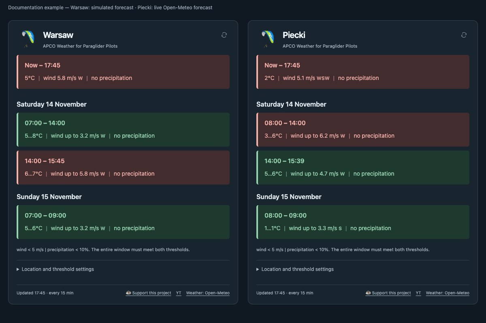
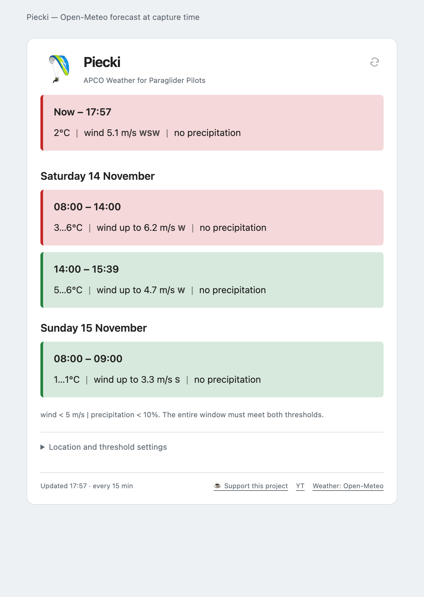
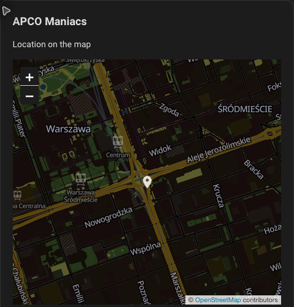

# APCO Weather

**English** · [Polski](README.pl.md) · [Italiano](README.it.md) · [Español](README.es.md)

A Home Assistant weather card for paraglider pilots. Choose an exact point on the map, set wind and precipitation thresholds, and see consecutive hours with the same assessment grouped into clear weather windows.

## Home Assistant integration and included card · preview

APCO Weather (formerly APCO Maniacs) now comes from one repository as an integration with its dashboard card included. Requires HA 2026.3+. The feature branch is a preview; stable 1.0.10 still uses the older Dashboard installation. The repository URL and technical IDs stay compatible. See the [installation and migration guide](docs/integration/README.md).

## Screenshots

Two separate, lossless PNG screenshots at 2× pixel density: Warsaw in the dark theme, and Piecki in the light theme. Both use the English interface. Captured from the same component in its standalone preview on 13 November 2026. Warsaw uses simulated example data (a green window from 07:00 to 14:00); Piecki shows the Open-Meteo forecast fetched at capture time. Demo data is never used by the installed card.

<h3>Warsaw · dark theme</h3>



See current conditions and the weather windows for the following days at a glance. Consecutive hours with the same assessment form one window, with temperature, maximum wind, wind direction and precipitation shown together.

This Warsaw example uses simulated data, including the green 07:00–14:00 window. Installed cards always request forecasts for their configured location.

<br clear="all">

<h3>Piecki · light theme</h3>



The card follows the active Home Assistant theme. Green and red backgrounds distinguish windows that meet your wind and precipitation thresholds from those that exceed them.

This screenshot uses the Open-Meteo forecast captured for Piecki. With daylight filtering enabled, windows end at the local sunset.

<br clear="all">

<h3>Choose your location</h3>



Open the visual card editor, click the map or drag the pin to your launch site, then name and save the card. Each card has its own location; your Home Assistant home location stays unchanged.

Actual Home Assistant editor showing central Warsaw: 52.2297, 21.0122. Set the location’s time zone separately in the editor.

<br clear="all">

- Native map with a draggable pin in the visual card editor; manual coordinates are also supported.
- Open-Meteo forecasts for the selected point, without a weather entity, Python integration or API key.
- Hourly assessments grouped into continuous windows, without a three-hour limit, with sunrise/sunset filtering.
- Polish, English, Italian and Spanish, including dates and number formatting; support for HA light and dark themes.
- A single installation file, with no libraries fetched from a CDN.

## Install with HACS

1. Add `https://github.com/piotrwozniak/apco-maniacs-card` in HACS custom repositories as **Integration**, and download **APCO Weather**. For this unreleased preview, install the ZIP built from this branch instead of stable 1.0.10.
2. Restart Home Assistant. Add **APCO Weather** in **Settings → Devices & services** and configure a named map location, time zone and thresholds.
3. Fully reload the frontend. The integration loads its bundled card automatically; no separate Dashboard package or resource entry is needed.
4. Add **APCO Weather** to your dashboard and select its **Conditions** sensor in the visual editor. Each location gets temperature, wind, precipitation probability and conditions sensors; fetching is shared every 15 minutes, even with the dashboard closed.

Example (use your actual Conditions entity ID):

```yaml
type: custom:apco-weather-card
entity: sensor.apco_weather_piecki_conditions
language: en
forecast_hours: 40
daylight_only: true
```

## Choose a location on the map

With an integration entity selected, edit the location and thresholds through Configure in Devices & services. Without an entity, use the card map described below.

Open the dashboard → Edit dashboard → Edit the APCO Weather card. Use the visual editor (switch from the code editor if needed), then click the map or drag the pin and save the card. This screenshot shows the native Home Assistant editor with Warsaw selected: latitude `52.2297`, longitude `21.0122`, time zone `Europe/Warsaw`.


## Language and localization

Without a `language` setting, the card follows the language of the current Home Assistant frontend: `pl`, `en`, `it` and `es`, including regional variants such as `it-IT` and `es-MX`. Unsupported languages fall back to English. Explicitly selecting one of the four languages takes priority; unrecognized values also fall back to English. New cards start with the language matching the HA frontend, and the visual editor lets you change it.

Labels, messages, weekdays, month names and number formatting are localized. Polish, Italian and Spanish use decimal commas; English uses decimal points. Time labels use the configured location time zone and a 24-hour clock. Outside HA, the default language is Polish unless explicitly configured. The README language is selected with the links at the top; GitHub and HACS do not automatically switch between these language versions.

## Migrate from the older manual installation

Keep your dashboard cards and back up their YAML. Remove only this project's old resource entries (`/hacsfiles/apco-maniacs-card/...`, `/local/apco-maniacs-card/...` or `/local/warun-web/warun-card.js`). Remove the old HACS **Dashboard** download, then install the **same repository as Integration**, restart HA and add APCO Weather in Devices & services. Fully reopen the browser.

`custom:apco-maniacs-card` and `custom:warun-card` remain supported. Cards without `entity` keep their existing direct-fetch settings; select Conditions to use server data. Do not overwrite HA configuration or delete legacy Warun entries. Legacy sources moved to `legacy/custom_components/` in this repository only. [Detailed update and rollback steps](docs/integration/README.md).

## Manual single-file installation

Copy [dist/apco-maniacs-card.js](dist/apco-maniacs-card.js) to `www/apco-maniacs-card/`. Add `/local/apco-maniacs-card/apco-maniacs-card.js?v=1.1.0-beta.1` as a **JavaScript module** resource. If you have just created `www`, restart HA. No separate CSS, translation or image files are required.

The source version in `warun-web/` still runs standalone and can also be deployed using four files. The detailed deployment guide, [wdrozenie.html](wdrozenie.html), is in Polish.

## How weather is assessed

An hour is green only when both wind speed and precipitation probability are **strictly below** your thresholds. A change in assessment, a gap in forecast timestamps or a calendar-day boundary starts a new window. Missing data receives a separate assessment. Temperature is shown as the range across the entire window; wind and precipitation are maxima, and the wind direction is taken from the hour with the strongest wind.

With daylight filtering enabled, today's window starts at the current full hour; subsequent days start at the first full hour at or after sunrise. Windows end no later than sunset. Weather assessment still uses hourly data even when sunset is at a time such as 17:24. Forecasts are fetched every 15 minutes; stale or incomplete data is not presented as good weather.

This card supports planning; it does not assess gusts, turbulence, thermals or terrain effects and cannot guarantee safe flying conditions. Coordinates are sent to Open-Meteo to request forecasts. The map tiles are handled by the native Home Assistant location editor.

## Support and videos

If you find the card useful, you can [buy me a coffee](https://buymeacoffee.com/piotrwoznil).

Videos and other projects: [Piotrek Lata on YouTube](https://www.youtube.com/@piter_fly).

## Development and releases

The build also writes the same JS into `custom_components/apco_maniacs/frontend/`. HACS now installs the integration and its bundled card from this same repository. `python3 scripts/package_integration.py` builds `output/apco-weather.zip`; releases attach the ZIP and standalone JS. CI validates category `integration` and tests HA 2026.3/2026.11.

Node.js 22 or later is required. There are no npm dependencies. The standalone `warun-web/` sources need no build step.

```sh
npm run build
npm test
npm run check:dist
python3 -m unittest discover -s tests
```

`npm run build` generates the single HACS file, embedding CSS and the header illustration. Regenerate and commit `dist/apco-maniacs-card.js` after source changes. CI checks tests, bundle freshness and HACS compatibility.

Public repository: [piotrwozniak/apco-maniacs-card](https://github.com/piotrwozniak/apco-maniacs-card). Before publishing another version, bump `package.json`, regenerate `dist`, push the commit, check Actions, and publish a matching release tag. The release workflow attaches the integration ZIP and the standalone JS file.

Installation as a HACS custom repository does not require inclusion in the default HACS catalog; catalog submission is a separate step. Local editor tests do not replace testing the map on a running HA instance with your frontend version.

Weather data: [Open-Meteo](https://open-meteo.com/), [CC BY 4.0](https://open-meteo.com/en/terms). Independent community project, not an official APCO Aviation product. The header illustration was generated with AI using APCO F1 MKII Azure #24 as a visual reference. Source code: [MIT](LICENSE).
