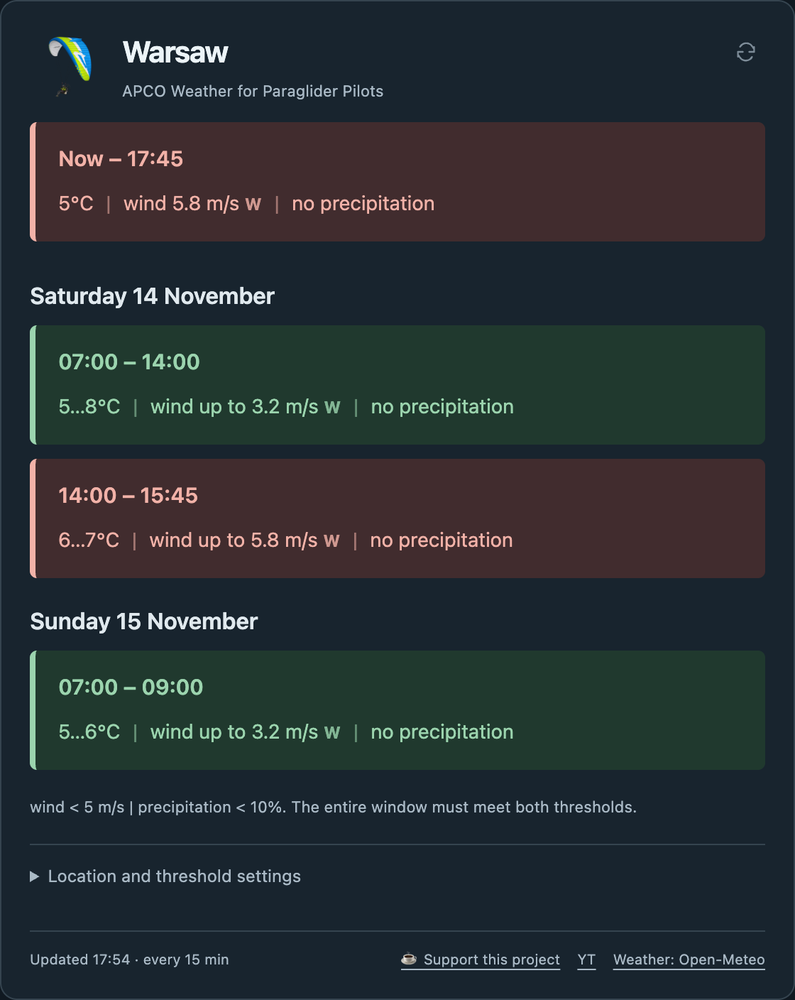
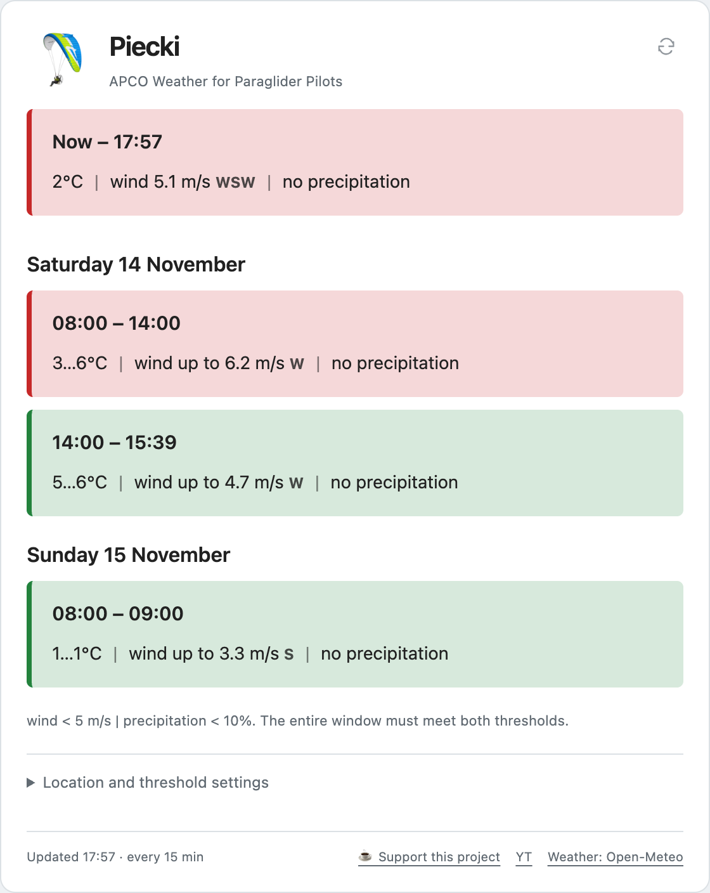

# APCO Maniacs

**Polski** · [English](README.md) · [Italiano](README.it.md) · [Español](README.es.md)

Karta pogodowa Home Assistant dla paralotniarzy. Wybierz dokładne miejsce na mapie, ustaw progi wiatru i opadów, a karta połączy kolejne godziny o podobnej ocenie w czytelne okna pogodowe.

## Zrzuty ekranu

Dwa osobne, bezstratne zrzuty PNG w podwójnej rozdzielczości: Warszawa w ciemnym motywie i Piecki w jasnym. Interfejs angielski. Zrzuty tego samego komponentu w podglądzie samodzielnym, wykonane 13 listopada 2026. Dane Warszawy są demonstracyjne (zielone okno 07:00–14:00); Piecki korzystają z prognozy Open-Meteo pobranej przy wykonywaniu zrzutów. Dane demonstracyjne nie są używane przez instalowaną kartę.





- Mapa z pinezką w graficznym edytorze karty; współrzędne można też wpisać ręcznie.
- Prognoza Open-Meteo dla wybranego punktu, bez encji pogodowej, integracji Python i klucza API.
- Godzinowa ocena, okna bez limitu 3 godzin, filtr wschodu i zachodu słońca.
- Języki PL, EN, IT i ES; motyw jasny i ciemny zgodny z HA.
- Jeden plik instalacyjny, bez bibliotek pobieranych z CDN.

## Instalacja przez HACS

Repozytorium do dodania: **https://github.com/piotrwozniak/apco-maniacs-card**.

1. Otwórz HACS → menu ⋮ → **Repozytoria niestandardowe**.
2. Wklej `https://github.com/piotrwozniak/apco-maniacs-card`, wybierz kategorię **Dashboard** i dodaj.
3. Znajdź **APCO Maniacs**, pobierz kartę i odśwież przeglądarkę.
4. Sprawdź zasoby dashboardu (`/config/lovelace/resources`). HACS powinien dodać moduł `apco-maniacs-card.js`. Gdy zasoby są zarządzane w YAML, dodaj go ręcznie, używając ścieżki wskazanej przez HACS.
5. Dodaj kartę **APCO Maniacs** z listy kart. W edytorze kliknij mapę lub przesuń pinezkę, ustaw nazwę i zapisz.

Nazwa repozytorium jest częścią ścieżki zasobu. Przy nazwie `apco-maniacs-card` jest to:

```text
/hacsfiles/apco-maniacs-card/apco-maniacs-card.js
```

Możesz też dodać kartę ręcznie:

```yaml
type: custom:apco-maniacs-card
name: Moje startowisko
latitude: 53.531944
longitude: 21.385556
language: pl
timezone: Europe/Warsaw
wind_threshold: 5
precip_threshold: 10
forecast_hours: 40
daylight_only: true
```

Każda karta zapisuje własną lokalizację. Wybór punktu nie zmienia lokalizacji Home Assistanta. Domyślnie nowa karta korzysta ze współrzędnych domu HA. Dla miejsca w innej strefie czasowej zmień także `timezone` w edytorze — nie jest automatycznie wyliczana z pinezki.

## Język i lokalizacja

Bez ustawienia `language` karta korzysta z języka interfejsu HA: `pl`, `en`, `it`, `es`, także wariantów regionalnych, np. `it-IT` i `es-MX`. Dla nieobsługiwanego języka włącza angielski. Jawny wybór jednego z czterech języków ma pierwszeństwo; nieznane wartości również przełączają na angielski. Nowe karty startują z językiem dopasowanym do HA, a w edytorze można go zmienić.

Tłumaczone są etykiety, komunikaty, dni tygodnia i miesiące; liczby mają przecinek w PL/IT/ES lub kropkę w EN. Czas jest wyświetlany w formacie 24-godzinnym według strefy lokalizacji. Poza HA domyślny język to polski. Język instrukcji wybierasz linkami na górze README — GitHub i HACS nie przełączają tych plików automatycznie.

## Przejście z ręcznej instalacji

Zachowaj konfiguracje istniejących kart Faryny/Piecki. Po instalacji przez HACS usuń z zasobów poprzedni wpis `/local/warun-web/warun-card.js?...` i pozostaw wyłącznie zasób HACS. Zamknij stronę i otwórz ją ponownie, żeby przeglądarka nie używała starej definicji komponentu. Typy `custom:apco-maniacs-card` i `custom:warun-card` nadal działają. Stare pliki w `www/warun-web` możesz pozostawić do czasu sprawdzenia nowej instalacji.

Nie podmieniaj przy tym `configuration.yaml`, automatyzacji ani scen. HACS instaluje wyłącznie kartę, bez plików konfiguracji HA i pomocniczej integracji Warun.

## Instalacja ręczna jednego pliku

Skopiuj [dist/apco-maniacs-card.js](dist/apco-maniacs-card.js) do `www/apco-maniacs-card/`. Dodaj zasób `/local/apco-maniacs-card/apco-maniacs-card.js?v=1.0.6` typu **Moduł JavaScript**. Przy pierwszym utworzeniu `www` zrestartuj HA. Nie potrzebujesz osobnych plików CSS, tłumaczeń ani grafiki.

Dotychczasowa wersja źródłowa w `warun-web/` nadal działa samodzielnie i może być wdrażana jako cztery pliki. Pełna instrukcja: [wdrozenie.html](wdrozenie.html).

## Jak karta ocenia pogodę

Godzina jest zielona tylko wtedy, gdy wiatr i prawdopodobieństwo opadów są **ściśle poniżej** ustawionych progów. Każda zmiana oceny, luka w prognozie lub granica dnia rozdziela okna. Brak danych ma osobną ocenę. Temperatura to zakres w całym oknie, a wiatr i opady to wartości maksymalne; kierunek odpowiada najsilniejszemu wiatrowi w oknie.

Przy włączonym filtrze dnia karta zaczyna od aktualnej pełnej godziny, kolejne dni od pierwszej pełnej godziny po wschodzie, i kończy okno najpóźniej o zachodzie. Ocena pogody jest godzinowa, nawet jeśli zachód wypada np. o 17:24. Pobieranie co 15 minut; przeterminowane lub niekompletne dane nie są przedstawiane jako dobre warunki.

Karta wspiera planowanie; nie ocenia turbulencji, porywów, termiki ani warunków terenowych. Nie jest gwarancją bezpiecznego lotu. Współrzędne wybranej lokalizacji są przesyłane do Open-Meteo w celu pobrania prognozy; podkład mapy jest obsługiwany przez natywny edytor HA.

## Wsparcie i filmy

Jeśli karta Ci się przydaje, możesz [postawić mi kawę](https://buymeacoffee.com/piotrwoznil).

Filmy i kolejne projekty: [Piotrek Lata — YouTube](https://www.youtube.com/@piter_fly).

## Rozwój i publikacja

Wymagany Node.js 22 lub nowszy. Brak zależności npm i brak kroku budowania dla samego `warun-web/`.

```sh
npm run build
npm test
npm run check:dist
python3 -m unittest discover -s tests
```

`npm run build` tworzy pojedynczy plik HACS ze źródeł i osadza CSS oraz grafikę. Po każdej zmianie źródeł odtwórz i skomituj `dist/apco-maniacs-card.js`. CI sprawdza testy, zgodność paczki ze źródłami oraz zgodność z HACS.

Publiczne repozytorium: [piotrwozniak/apco-maniacs-card](https://github.com/piotrwozniak/apco-maniacs-card). Pierwsza wersja ma tag `v1.0.0`. Przed publikacją kolejnej wersji sprawdź wynik Actions. Workflow `Attach HACS bundle` dołączy jeden plik JS. Przy kolejnej wersji podnieś numer w `package.json`, odtwórz `dist`, wyślij commit i utwórz odpowiadający mu release.

Repozytorium można instalować jako niestandardowe bez zgłaszania go do domyślnego katalogu HACS. Zgłoszenie do katalogu to oddzielny krok. Bez testu na działającym HA nie traktuj lokalnych testów edytora jako potwierdzenia działania konkretnej wersji frontendu HA.

Weather data: [Open-Meteo](https://open-meteo.com/), [CC BY 4.0](https://open-meteo.com/en/terms). Independent community project, not an official APCO Aviation product. The header illustration was generated with AI using APCO F1 MKII Azure #24 as a visual reference. Source code: [MIT](LICENSE).
